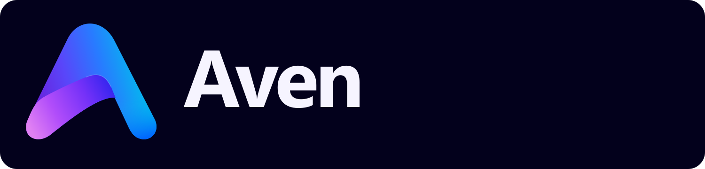

# Aven / My Browser 4 Ever — Asset-Paket

[Gesamtübersicht ansehen](previews/asset-overview.png) · [Galerie herunterladen/öffnen](index.html) · [Originalbild](reference/original.png)

Aus dem angehängten Referenzbild abgeleitet. Das Zeichen ist eine manuelle SVG-Nachzeichnung, keine pixelgenaue Original-Vektordatei. Die Palette wurde visuell aus der Vorlage abgeleitet. Kein neues KI-Bild wurde erzeugt.

## Enthalten
- Logo: farbig, weiß, dunkel, Wortmarken und App-Symbole
- Drei zusätzliche Aven-Wortmarken (dunkel, hell, transparent); die bisherigen My-Browser-4-Ever-Versionen bleiben erhalten
- 16 Browser-Icons als SVG plus Sprite
- 6 editierbare Farbverläufe als SVG und CSS
- Hintergründe für Desktop, Mobiltelefon, neuen Tab und Social Media
- PNG-Exporte, Favicon (.ico), Farbwerte (CSS / JSON), Originalbild und Gesamtübersicht

## Anwendung
SVGs sind beliebig skalierbar. Für kleine Größen das reine Zeichen verwenden. Mindestens 15 % der Zeichenbreite als Abstand freihalten. Das weiße Zeichen auf dunklen oder farbigen Flächen verwenden, das dunkle Zeichen auf hellen Flächen. Die Wortmarke nutzt Segoe UI mit Arial als Ersatz; sie enthält editierbaren Text. Die Wortmarke ist ein Vorschlag zum genannten Projektnamen.

Die Gradient-SVGs sind absichtlich einfache Flächen ohne Text. CSS-Verläufe stehen in tokens/brand.css. Die Icons können über currentColor umgefärbt werden. Text für Funktionen in heller Neutralfarbe setzen; dekorative Verläufe nicht als kleinen Fließtext verwenden. Das maskierbare App-Symbol hat einen rechteckigen Hintergrund und zusätzlichen Innenabstand.

Öffne index.html für die komplette Galerie. Dieses Paket liegt im Repository unter assets/.
